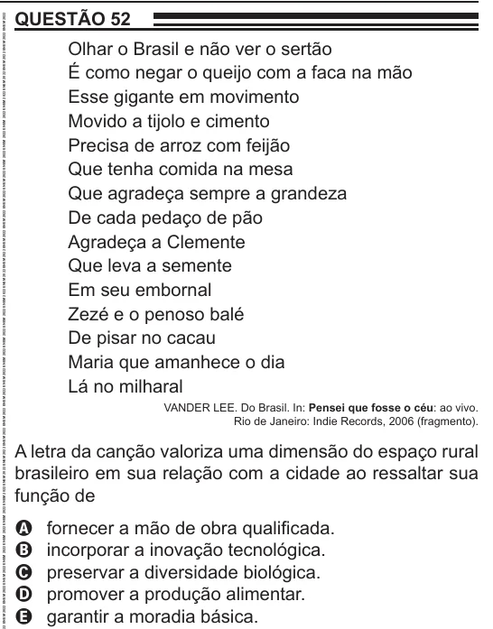

Texto extraído (pode conter ruído)

QUESTÃO 52  
Olhar o Brasil e não ver o sertão  
É como negar o queijo com a faca na mão  
Esse gigante em movimento  
Movido a tijolo e cimento  
Precisa de arroz com feijão  
Que tenha comida na mesa  
Que agradeça sempre a grandeza  
De cada pedaço de pão  
Agradeça a Clemente  
Que leva a semente  
Em seu embornal  
Zezé e o penoso balé  
De pisar no cacau  
Maria que amanhece o dia  
Lá no milharal  
VANDER LEE. Do Brasil. In: Pensei que fosse o céu: ao vivo.  
Rio de Janeiro: Indie Records, 2006 (fragmento).  
A letra da canção valoriza uma dimensão do espaço rural  
brasileiro em sua relação com a cidade ao ressaltar sua  
função de  
fornecer a mão de obra qualificada.  
A  
incorporar a inovação tecnológica.  
B  
preservar a diversidade biológica.  
C  
D  
promover a produção alimentar.  
E  
garantir a moradia básica.

