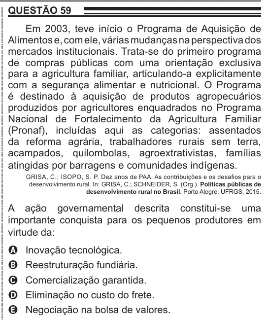

Texto extraído (pode conter ruído)

QUESTÃO 59  
Em 2003, teve início o Programa de Aquisição de  
Alimentos e, com ele, várias mudanças na perspectiva dos  
mercados institucionais. Trata-se do primeiro programa  
de compras públicas com uma orientação exclusiva  
para a agricultura familiar, articulando-a explicitamente  
com a segurança alimentar e nutricional. O Programa  
é destinado à aquisição de produtos agropecuários  
produzidos por agricultores enquadrados no Programa  
Nacional de Fortalecimento da Agricultura Familiar  
(Pronaf), incluídas aqui as categorias: assentados  
da reforma agrária, trabalhadores rurais sem terra,  
acampados, quilombolas, agroextrativistas, famílias  
atingidas por barragens e comunidades indígenas.  
GRISA, C.; ISOPO, S. P. Dez anos de PAA: As contribuições e os desafios para o  
desenvolvimento rural. In: GRISA, C.; SCHNEIDER, S. (Org.). Políticas públicas de  
desenvolvimento rural no Brasil. Porto Alegre: UFRGS, 2015.  
A ação governamental descrita constitui-se uma  
importante conquista para os pequenos produtores em  
virtude da:  
Inovação tecnológica.  
A  
Reestruturação fundiária.  
B  
Comercialização garantida.  
C  
Eliminação no custo do frete.  
D  
Negociação na bolsa de valores.  
E

