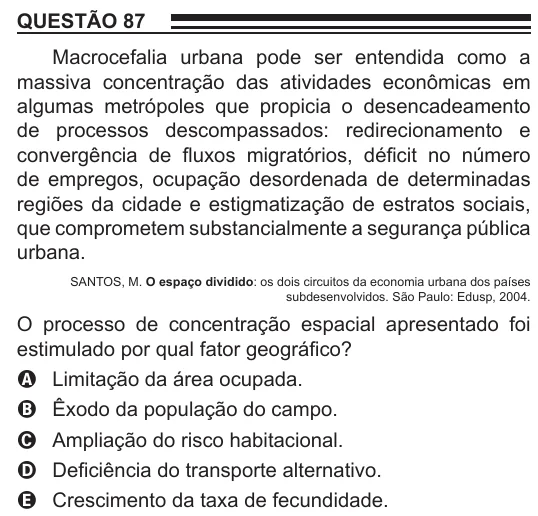

Texto extraído (pode conter ruído)

QUESTÃO 87  
Macrocefalia urbana pode ser entendida como a  
massiva concentração das atividades econômicas em  
algumas metrópoles que propicia o desencadeamento  
de processos descompassados: redirecionamento e  
convergência de fluxos migratórios, déficit no número  
de empregos, ocupação desordenada de determinadas  
regiões da cidade e estigmatização de estratos sociais,  
que comprometem substancialmente a segurança pública  
urbana.  
SANTOS, M. O espaço dividido: os dois circuitos da economia urbana dos países  
subdesenvolvidos. São Paulo: Edusp, 2004.  
O processo de concentração espacial apresentado foi  
estimulado por qual fator geográfico?  
A Limitação da área ocupada.  
B Êxodo da população do campo.  
C Ampliação do risco habitacional.  
D Deficiência do transporte alternativo.  
E Crescimento da taxa de fecundidade.

