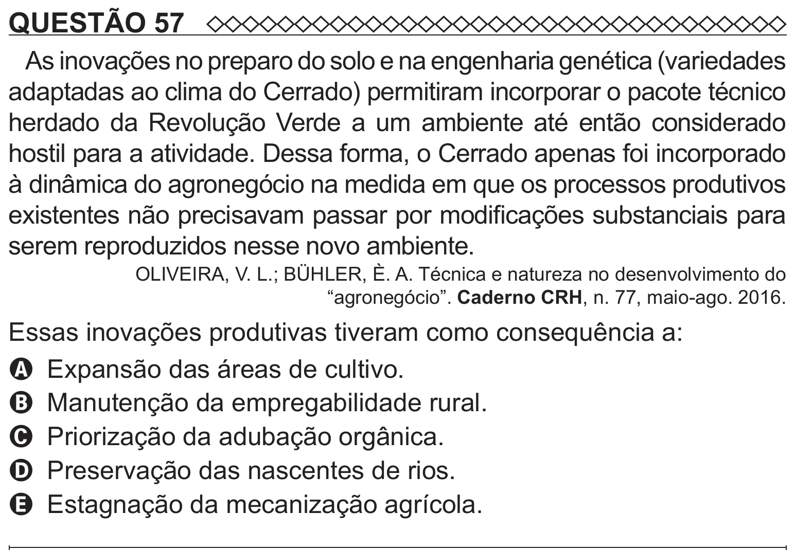

Texto extraído (pode conter ruído)

QUESTÃO 57  
As inovações no preparo do solo e na engenharia genética (variedades  
adaptadas ao clima do Cerrado) permitiram incorporar o pacote técnico  
herdado da Revolução Verde a um ambiente até então considerado  
hostil para a atividade. Dessa forma, o Cerrado apenas foi incorporado  
à dinâmica do agronegócio na medida em que os processos produtivos  
existentes não precisavam passar por modificações substanciais para  
serem reproduzidos nesse novo ambiente.  
OLIVEIRA, V. L.; BÜHLER, È. A. Técnica e natureza no desenvolvimento do  
“agronegócio”. Caderno CRH, n. 77, maio-ago. 2016.  
Essas inovações produtivas tiveram como consequência a:  
A Expansão das áreas de cultivo.  
B Manutenção da empregabilidade rural.  
C Priorização da adubação orgânica.  
D Preservação das nascentes de rios.  
E Estagnação da mecanização agrícola.

