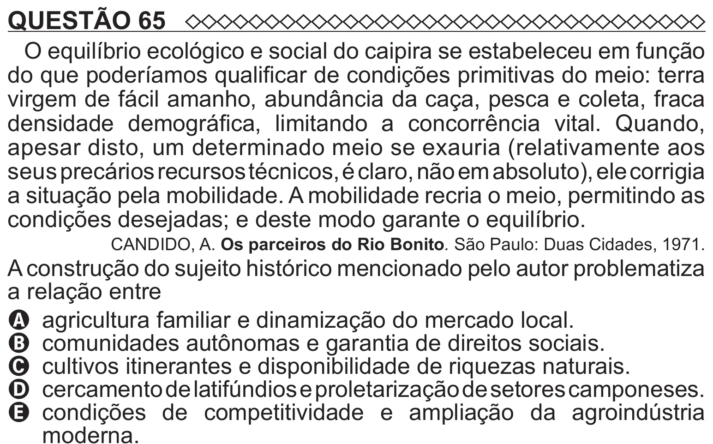

Texto extraído (pode conter ruído)

QUESTÃO 65  
O equilíbrio ecológico e social do caipira se estabeleceu em função  
do que poderíamos qualificar de condições primitivas do meio: terra  
virgem de fácil amanho, abundância da caça, pesca e coleta, fraca  
densidade demográfica, limitando a concorrência vital. Quando,  
apesar disto, um determinado meio se exauria (relativamente aos  
seus precários recursos técnicos, é claro, não em absoluto), ele corrigia  
a situação pela mobilidade. A mobilidade recria o meio, permitindo as  
condições desejadas; e deste modo garante o equilíbrio.  
CANDIDO, A. Os parceiros do Rio Bonito. São Paulo: Duas Cidades, 1971.  
A construção do sujeito histórico mencionado pelo autor problematiza  
a relação entre  
A agricultura familiar e dinamização do mercado local.  
B comunidades autônomas e garantia de direitos sociais.  
C cultivos itinerantes e disponibilidade de riquezas naturais.  
D cercamento de latifúndios e proletarização de setores camponeses.  
E   
condições de competitividade e ampliação da agroindústria

