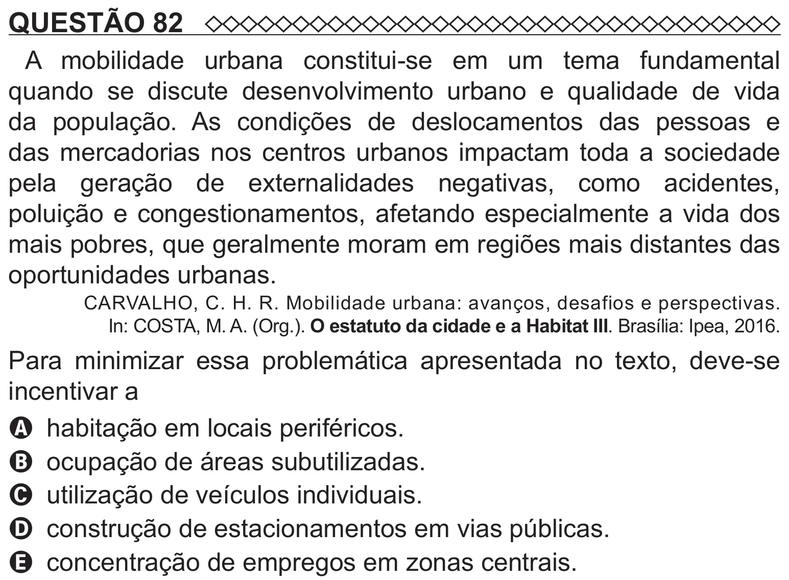

Texto extraído (pode conter ruído)

QUESTÃO 82  
A mobilidade urbana constitui-se em um tema fundamental  
quando se discute desenvolvimento urbano e qualidade de vida  
da população. As condições de deslocamentos das pessoas e  
das mercadorias nos centros urbanos impactam toda a sociedade  
pela geração de externalidades negativas, como acidentes,  
poluição e congestionamentos, afetando especialmente a vida dos  
mais pobres, que geralmente moram em regiões mais distantes das  
oportunidades urbanas.  
CARVALHO, C. H. R. Mobilidade urbana: avanços, desafios e perspectivas.  
In: COSTA, M. A. (Org.). O estatuto da cidade e a Habitat III. Brasília: Ipea, 2016.  
Para minimizar essa problemática apresentada no texto, deve-se  
incentivar a  
A habitação em locais periféricos.  
B ocupação de áreas subutilizadas.  
C utilização de veículos individuais.  
D construção de estacionamentos em vias públicas.  
E concentração de empregos em zonas centrais.

