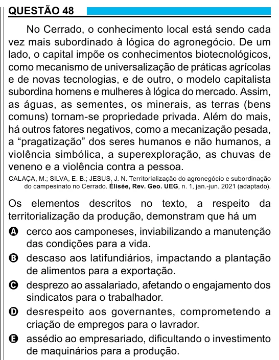

Texto extraído (pode conter ruído)

QUESTÃO 48  
No Cerrado, o conhecimento local está sendo cada  
vez mais subordinado à lógica do agronegócio. De um  
lado, o capital impõe os conhecimentos biotecnológicos,  
como mecanismo de universalização de práticas agrícolas  
e de novas tecnologias, e de outro, o modelo capitalista  
subordina homens e mulheres à lógica do mercado. Assim,  
as águas, as sementes, os minerais, as terras (bens  
comuns) tornam-se propriedade privada. Além do mais,  
há outros fatores negativos, como a mecanização pesada,  
a “pragatização” dos seres humanos e não humanos, a  
violência simbólica, a superexploração, as chuvas de  
veneno e a violência contra a pessoa.  
CALAÇA, M.; SILVA, E. B.; JESUS, J. N. Territorialização do agronegócio e subordinação  
do campesinato no Cerrado. Élisée, Rev. Geo. UEG, n. 1, jan.-jun. 2021 (adaptado).  
Os elementos descritos no texto, a respeito da  
territorialização da produção, demonstram que há um  
A cerco aos camponeses, inviabilizando a manutenção  
das condições para a vida.  
B descaso aos latifundiários, impactando a plantação  
de alimentos para a exportação.  
C desprezo ao assalariado, afetando o engajamento dos  
sindicatos para o trabalhador.  
D desrespeito aos governantes, comprometendo a  
criação de empregos para o lavrador.  
E assédio ao empresariado, dificultando o investimento  
de maquinários para a produção.

