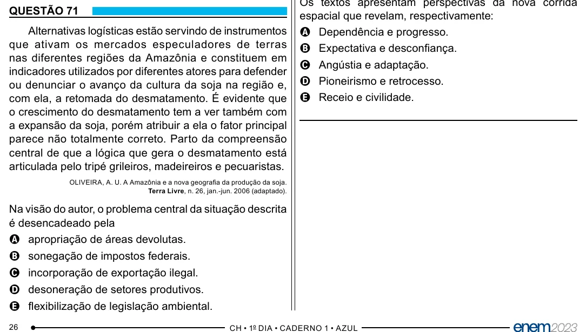

Texto extraído (pode conter ruído)

QUESTÃO 71  
espacial que revelam, respectivamente:  
Alternativas logísticas estão servindo de instrumentos  
A Dependência e progresso.  
que ativam os mercados especuladores de terras  
B Expectativa e desconfiança.  
nas diferentes regiões da Amazônia e constituem em  
C Angústia e adaptação.  
indicadores utilizados por diferentes atores para defender  
D Pioneirismo e retrocesso.  
ou denunciar o avanço da cultura da soja na região e,  
com ela, a retomada do desmatamento. É evidente que  
E Receio e civilidade.  
o crescimento do desmatamento tem a ver também com  
a expansão da soja, porém atribuir a ela o fator principal  
parece não totalmente correto. Parto da compreensão  
central de que a lógica que gera o desmatamento está  
articulada pelo tripé grileiros, madeireiros e pecuaristas.  
OLIVEIRA, A. U. A Amazônia e a nova geografia da produção da soja.  
Terra Livre, n. 26, jan.-jun. 2006 (adaptado).  
Na visão do autor, o problema central da situação descrita  
é desencadeado pela  
A apropriação de áreas devolutas.  
B sonegação de impostos federais.  
C incorporação de exportação ilegal.  
D desoneração de setores produtivos.  
E flexibilização de legislação ambiental.  
26

