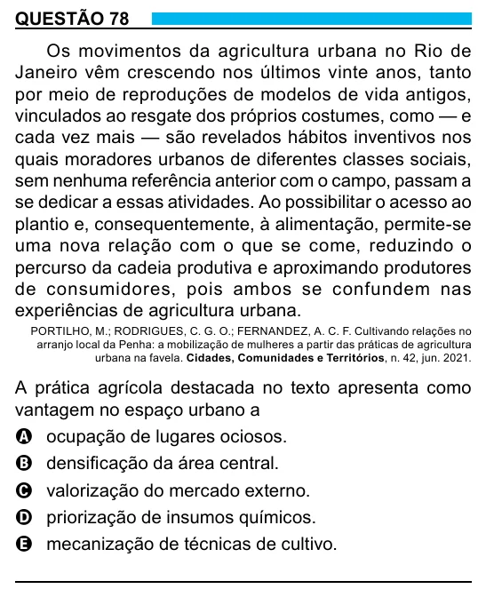

Texto extraído (pode conter ruído)

QUESTÃO 78  
Os movimentos da agricultura urbana no Rio de  
Janeiro vêm crescendo nos últimos vinte anos, tanto  
por meio de reproduções de modelos de vida antigos,  
vinculados ao resgate dos próprios costumes, como — e  
cada vez mais — são revelados hábitos inventivos nos  
quais moradores urbanos de diferentes classes sociais,  
sem nenhuma referência anterior com o campo, passam a  
se dedicar a essas atividades. Ao possibilitar o acesso ao  
plantio e, consequentemente, à alimentação, permite-se  
uma nova relação com o que se come, reduzindo o  
percurso da cadeia produtiva e aproximando produtores  
de consumidores, pois ambos se confundem nas  
experiências de agricultura urbana.  
PORTILHO, M.; RODRIGUES, C. G. O.; FERNANDEZ, A. C. F. Cultivando relações no  
arranjo local da Penha: a mobilização de mulheres a partir das práticas de agricultura  
urbana na favela. Cidades, Comunidades e Territórios, n. 42, jun. 2021.  
A prática agrícola destacada no texto apresenta como  
vantagem no espaço urbano a  
A ocupação de lugares ociosos.  
B densificação da área central.  
C valorização do mercado externo.  
D priorização de insumos químicos.  
E mecanização de técnicas de cultivo.  
28

