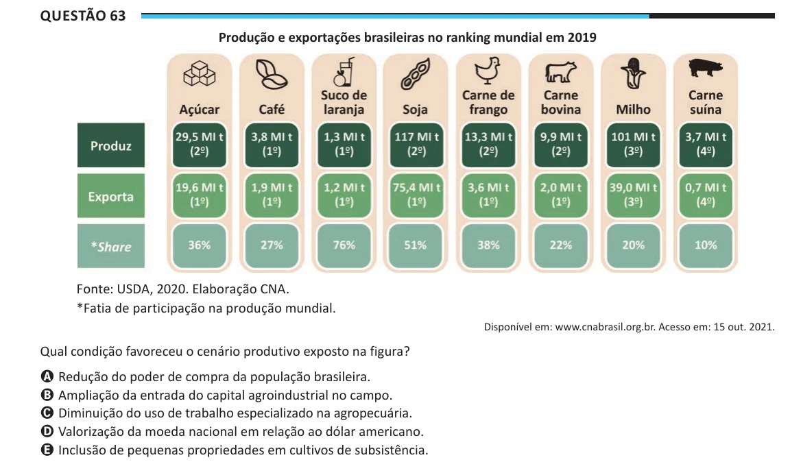

Texto extraído (pode conter ruído)

Questão 63  
Produção e exportações brasileiras no ranking mundial em 2019  
Fonte: USDA, 2020. Elaboração CNA.  
*Fatia de participação na produção mundial.  
Disponível em: www.cnabrasil.org.br. Acesso em: 15 out. 2021.  
Qual condição favoreceu o cenário produtivo exposto na figura?  
A Redução do poder de compra da população brasileira.  
B Ampliação da entrada do capital agroindustrial no campo.  
C Diminuição do uso de trabalho especializado na agropecuária.  
D Valorização da moeda nacional em relação ao dólar americano.  
E Inclusão de pequenas propriedades em cultivos de subsistência.

