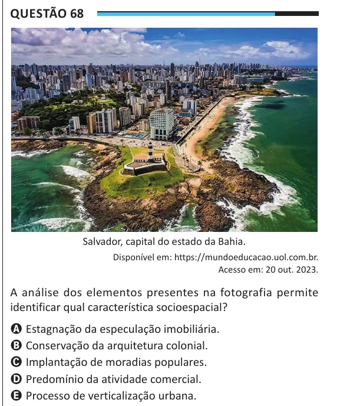

Texto extraído (pode conter ruído)

Questão 68  
Salvador, capital do estado da Bahia.  
Disponível em: https://mundoeducacao.uol.com.br.  
Acesso em: 20 out. 2023.  
A análise dos elementos presentes na fotografia permite  
identificar qual característica socioespacial?  
A Estagnação da especulação imobiliária.  
B Conservação da arquitetura colonial.  
C Implantação de moradias populares.  
D Predomínio da atividade comercial.  
E Processo de verticalização urbana.

