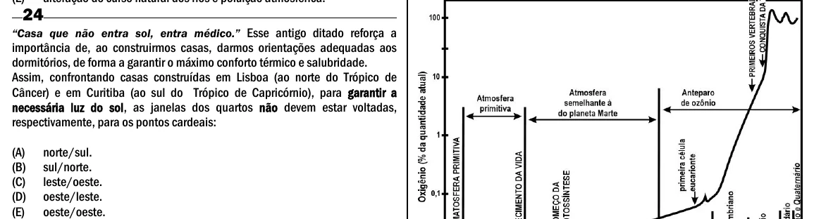

Texto extraído (pode conter ruído)

24  
―Casa que não entra sol, entra médico.‖ Esse antigo ditado reforça a  
importância de, ao construirmos casas, darmos orientações adequadas aos  
dormitórios, de forma a garantir o máximo conforto térmico e salubridade.  
Assim, confrontando casas construídas em Lisboa (ao norte do Trópico de  
Câncer) e em Curitiba (ao sul do Trópico de Capricórnio), para garantir a  
necessária luz do sol, as janelas dos quartos não devem estar voltadas,  
respectivamente, para os pontos cardeais:  
(A)  
norte/sul.  
(B)  
sul/norte.  
(C)  
leste/oeste.  
(D)  
oeste/leste.  
(E)  
oeste/oeste.

