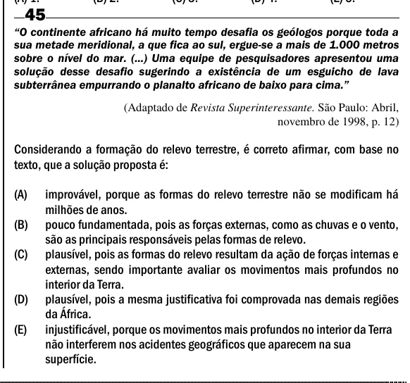

Texto extraído (pode conter ruído)

45  
―O continente africano há muito tempo desafia os geólogos porque toda a  
sua metade meridional, a que fica ao sul, ergue-se a mais de 1.000 metros  
sobre o nível do mar. (...) Uma equipe de pesquisadores apresentou uma  
solução desse desafio sugerindo a existência de um esguicho de lava  
subterrânea empurrando o planalto africano de baixo para cima.‖  
(Adaptado de Revista Superinteressante. São Paulo: Abril,  
novembro de 1998, p. 12)  
Considerando a formação do relevo terrestre, é correto afirmar, com base no  
texto, que a solução proposta é:  
(A)  
improvável, porque as formas do relevo terrestre não se modificam há  
milhões de anos.  
(B)  
pouco fundamentada, pois as forças externas, como as chuvas e o vento,  
são as principais responsáveis pelas formas de relevo.  
(C)  
plausível, pois as formas do relevo resultam da ação de forças internas e  
externas, sendo importante avaliar os movimentos mais profundos no  
interior da Terra.  
(D)  
plausível, pois a mesma justificativa foi comprovada nas demais regiões  
da África.  
(E)  
injustificável, porque os movimentos mais profundos no interior da Terra  
não interferem nos acidentes geográficos que aparecem na sua  
superfície.

