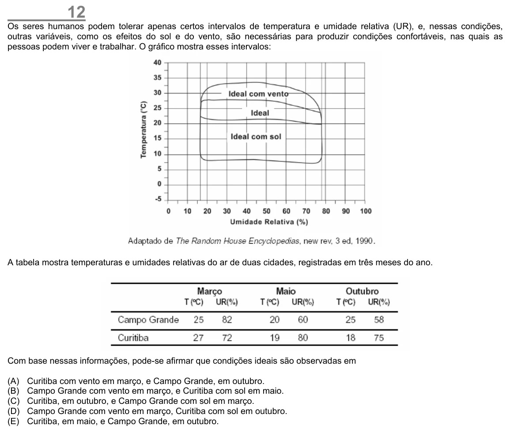

Texto extraído (pode conter ruído)

12  
Os seres humanos podem tolerar apenas certos intervalos de temperatura e umidade relativa (UR), e, nessas condições,  
outras variáveis, como os efeitos do sol e do vento, são necessárias para produzir condições confortáveis, nas quais as  
pessoas podem viver e trabalhar. O gráfico mostra esses intervalos:  
A tabela mostra temperaturas e umidades relativas do ar de duas cidades, registradas em três meses do ano.  
Com base nessas informações, pode-se afirmar que condições ideais são observadas em  
(A)  
Curitiba com vento em março, e Campo Grande, em outubro.  
(B)  
Campo Grande com vento em março, e Curitiba com sol em maio.  
(C)  
Curitiba, em outubro, e Campo Grande com sol em março.  
(D)  
Campo Grande com vento em março, Curitiba com sol em outubro.  
(E)  
Curitiba, em maio, e Campo Grande, em outubro.

