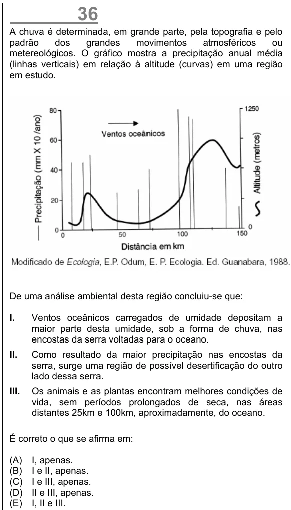

Texto extraído (pode conter ruído)

36  
A chuva é determinada, em grande parte, pela topografia e pelo  
padrão  
dos  
grandes  
movimentos  
atmosféricos  
ou  
metereológicos. O gráfico mostra a precipitação anual média  
(linhas verticais) em relação à altitude (curvas) em uma região  
em estudo.  
De uma análise ambiental desta região concluiu-se que:  
I.  
Ventos oceânicos carregados de umidade depositam a  
maior parte desta umidade, sob a forma de chuva, nas  
encostas da serra voltadas para o oceano.  
II.  
Como resultado da maior precipitação nas encostas da  
serra, surge uma região de possível desertificação do outro  
lado dessa serra.  
III.  
Os animais e as plantas encontram melhores condições de  
vida, sem períodos prolongados de seca, nas áreas  
distantes 25km e 100km, aproximadamente, do oceano.  
É correto o que se afirma em:  
(A)  
I, apenas.  
(B)  
I e II, apenas.  
(C)  
I e III, apenas.  
(D)  
II e III, apenas.  
(E)  
I, II e III.

