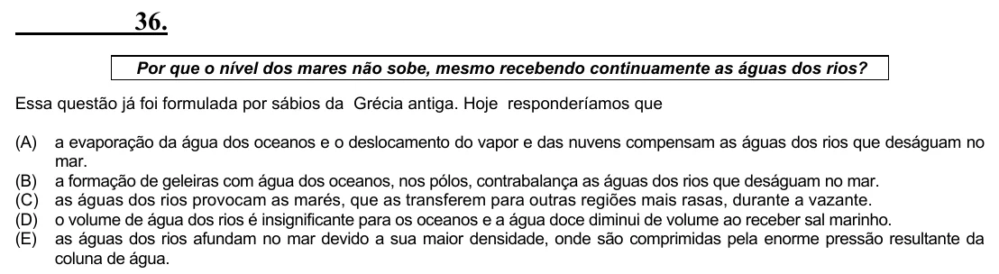

Texto extraído (pode conter ruído)

36.  
Por que o nível dos mares não sobe, mesmo recebendo continuamente as águas dos rios?  
Essa questão já foi formulada por sábios da Grécia antiga. Hoje responderíamos que  
(A)  
a evaporação da água dos oceanos e o deslocamento do vapor e das nuvens compensam as águas dos rios que deságuam no  
mar.  
(B) a formação de geleiras com água dos oceanos, nos pólos, contrabalança as águas dos rios que deságuam no mar.  
(C) as águas dos rios provocam as marés, que as transferem para outras regiões mais rasas, durante a vazante.  
(D) o volume de água dos rios é insignificante para os oceanos e a água doce diminui de volume ao receber sal marinho.  
(E) as águas dos rios afundam no mar devido a sua maior densidade, onde são comprimidas pela enorme pressão resultante da  
coluna de água.

