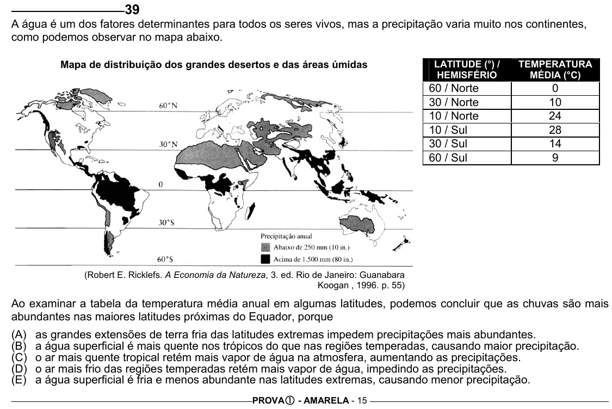

Texto extraído (pode conter ruído)

39  
A água é um dos fatores determinantes para todos os seres vivos, mas a precipitação varia muito nos continentes,  
como podemos observar no mapa abaixo.  
Mapa de distribuição dos grandes desertos e das áreas úmidas  
LATITUDE (°) /  
TEMPERATURA  
HEMISFÉRIO  
MÉDIA (°C)  
60 / Norte  
0  
30 / Norte  
10  
10 / Norte  
24  
10 / Sul  
28  
30 / Sul  
14  
60 / Sul  
9  
(Robert E. Ricklefs. A Economia da Natureza, 3. ed. Rio de Janeiro: Guanabara  
Koogan , 1996. p. 55)  
Ao examinar a tabela da temperatura média anual em algumas latitudes, podemos concluir que as chuvas são mais  
abundantes nas maiores latitudes próximas do Equador, porque  
(A)  
as grandes extensões de terra fria das latitudes extremas impedem precipitações mais abundantes.  
(B)  
a água superficial é mais quente nos trópicos do que nas regiões temperadas, causando maior precipitação.  
(C)  
o ar mais quente tropical retém mais vapor de água na atmosfera, aumentando as precipitações.  
(D)  
o ar mais frio das regiões temperadas retém mais vapor de água, impedindo as precipitações.  
(E)  
a água superficial é fria e menos abundante nas latitudes extremas, causando menor precipitação.  
PROVA c - AMARELA - 15

