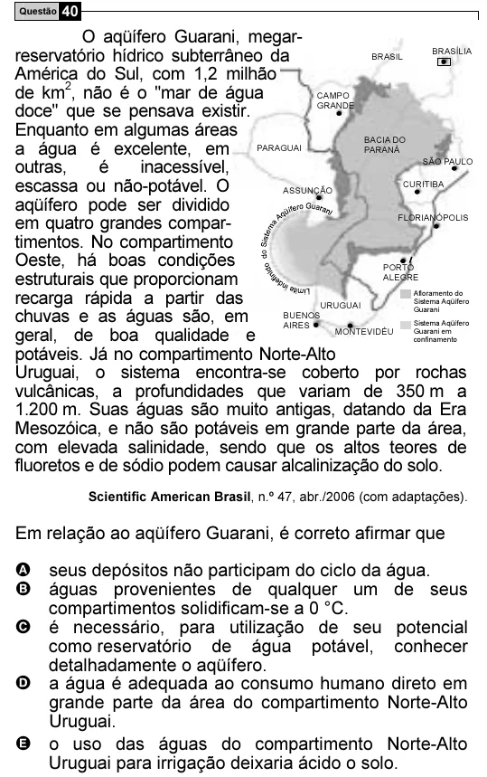

Texto extraído (pode conter ruído)

Questão 40  
O aqüífero Guarani, megar-  
reservatório hídrico subterrâneo da  
BRASÍLIA  
BRASIL  
América do Sul, com 1,2 milhão  
de km 2 , não é o "mar de água  
CAMPO  
GRANDE  
doce" que se pensava existir.  
Enquanto em algumas áreas  
BACIA DO  
a água é excelente, em  
PARAGUAI  
PARANÁ  
SÃO PAULO  
outras,  
é  
inacessível,  
escassa ou não-potável. O  
CURITIBA  
ASSUNÇÃO  
aqüífero pode ser dividido  
FLORIANÓPOLIS  
em quatro grandes compar-  
timentos. No compartimento  
Oeste, há boas condições  
PORTO  
estruturais que proporcionam  
ALEGRE  
recarga rápida a partir das  
Afloramento do  
Sistema Aqüífero  
URUGUAI  
chuvas e as águas são, em  
Guarani  
BUENOS  
AIRES  
Sistema Aqüífero  
MONTEVIDÉU  
geral, de boa qualidade e  
Guarani  
em  
confinamento  
potáveis. Já no compartimento Norte-Alto  
Uruguai, o sistema encontra-se coberto por rochas  
vulcânicas, a profundidades que variam de 350 m a  
1.200 m. Suas águas são muito antigas, datando da Era  
Mesozóica, e não são potáveis em grande parte da área,  
com elevada salinidade, sendo que os altos teores de  
fluoretos e de sódio podem causar alcalinização do solo.  
Scientific American Brasil, n.º 47, abr./2006 (com adaptações).  
Em relação ao aqüífero Guarani, é correto afirmar que  
A seus depósitos não participam do ciclo da água.  
B águas provenientes de qualquer um de seus  
compartimentos solidificam-se a 0 °C.  
C é necessário, para utilização de seu potencial  
como reservatório de água potável, conhecer  
detalhadamente o aqüífero.  
D a água é adequada ao consumo humano direto em  
grande parte da área do compartimento Norte-Alto  
Uruguai.  
E o uso das águas do compartimento Norte-Alto  
Uruguai para irrigação deixaria ácido o solo.

