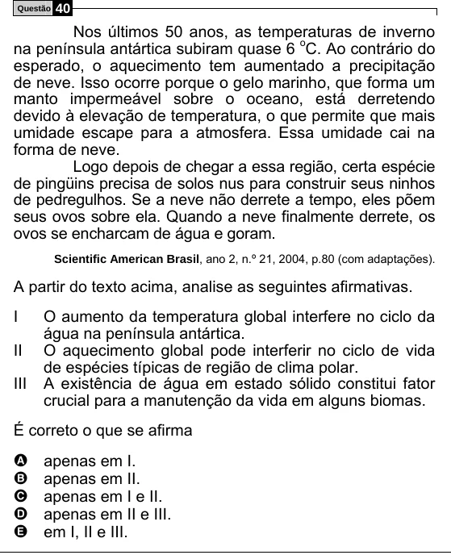

Texto extraído (pode conter ruído)

Questão  
40  
Nos últimos 50 anos, as temperaturas de inverno  
na península antártica subiram quase 6 o C. Ao contrário do  
esperado, o aquecimento tem aumentado a precipitação  
de neve. Isso ocorre porque o gelo marinho, que forma um  
manto impermeável sobre o oceano, está derretendo  
devido à elevação de temperatura, o que permite que mais  
umidade escape para a atmosfera. Essa umidade cai na  
forma de neve.  
Logo depois de chegar a essa região, certa espécie  
de pingüins precisa de solos nus para construir seus ninhos  
de pedregulhos. Se a neve não derrete a tempo, eles põem  
seus ovos sobre ela. Quando a neve finalmente derrete, os  
ovos se encharcam de água e goram.  
Scientific American Brasil, ano 2, n.º 21, 2004, p.80 (com adaptações).  
A partir do texto acima, analise as seguintes afirmativas.  
I  
O aumento da temperatura global interfere no ciclo da  
água na península antártica.  
II  
O aquecimento global pode interferir no ciclo de vida  
de espécies típicas de região de clima polar.  
III  
A existência de água em estado sólido constitui fator  
crucial para a manutenção da vida em alguns biomas.  
É correto o que se afirma  
A  
apenas em I.  
apenas em II.  
B  
C  
apenas em I e II.  
apenas em II e III.  
D  
E  
em I, II e III.

