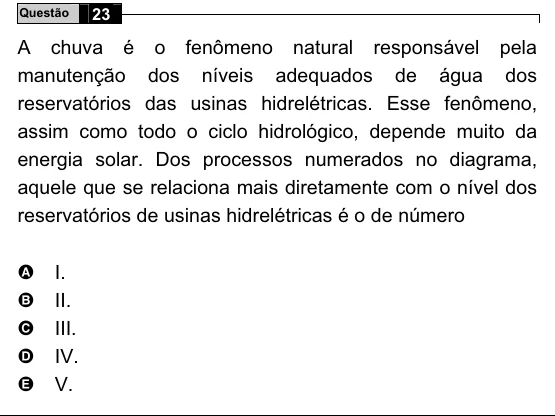

Texto extraído (pode conter ruído)

23  
Questão  
A chuva é o fenômeno natural responsável pela  
manutenção dos níveis adequados de água dos  
reservatórios das usinas hidrelétricas. Esse fenômeno,  
assim como todo o ciclo hidrológico, depende muito da  
energia solar. Dos processos numerados no diagrama,  
aquele que se relaciona mais diretamente com o nível dos  
reservatórios de usinas hidrelétricas é o de número  
A  
I.  
II.  
B  
C  
III.  
IV.  
D  
E  
V.

