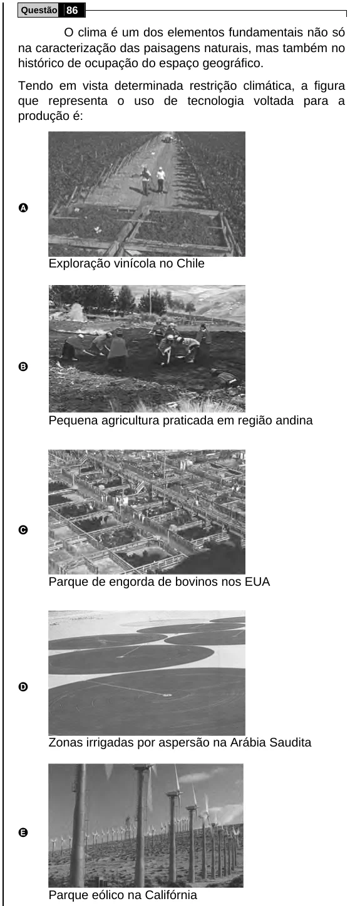

Texto extraído (pode conter ruído)

Questão 86  
O clima é um dos elementos fundamentais não só  
na caracterização das paisagens naturais, mas também no  
histórico de ocupação do espaço geográfico.  
Tendo em vista determinada restrição climática, a figura  
que representa o uso de tecnologia voltada para a  
produção é:  
A  
Exploração vinícola no Chile  
B  
Pequena agricultura praticada em região andina  
C  
Parque de engorda de bovinos nos EUA  
D  
Zonas irrigadas por aspersão na Arábia Saudita  
E  
Parque eólico na Califórnia

