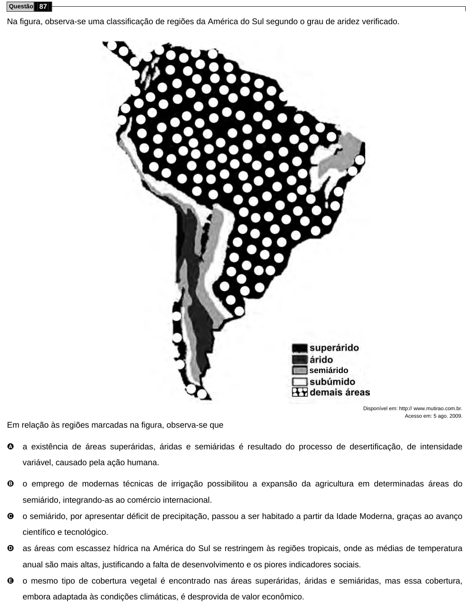

Texto extraído (pode conter ruído)

Questão 87  
Na figura, observa-se uma classificação de regiões da América do Sul segundo o grau de aridez verificado.  
semiárido  
Disponível em: http:// www.mutirao.com.br.  
Acesso em: 5 ago. 2009.  
Em relação às regiões marcadas na figura, observa-se que  
A  
a existência de áreas superáridas, áridas e semiáridas é resultado do processo de desertificação, de intensidade  
variável, causado pela ação humana.  
B  
o emprego de modernas técnicas de irrigação possibilitou a expansão da agricultura em determinadas áreas do  
semiárido, integrando-as ao comércio internacional.  
C  
o semiárido, por apresentar déficit de precipitação, passou a ser habitado a partir da Idade Moderna, graças ao avanço  
científico e tecnológico.  
D  
as áreas com escassez hídrica na América do Sul se restringem às regiões tropicais, onde as médias de temperatura  
anual são mais altas, justificando a falta de desenvolvimento e os piores indicadores sociais.  
E  
o mesmo tipo de cobertura vegetal é encontrado nas áreas superáridas, áridas e semiáridas, mas essa cobertura,  
embora adaptada às condições climáticas, é desprovida de valor econômico.

