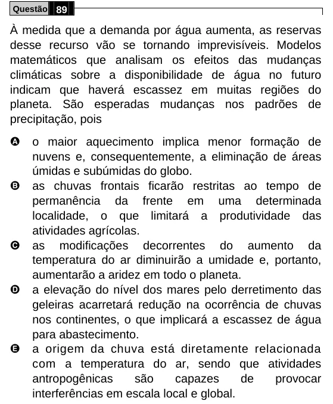

Texto extraído (pode conter ruído)

Questão 89  
À medida que a demanda por água aumenta, as reservas  
desse recurso vão se tornando imprevisíveis. Modelos  
matemáticos que analisam os efeitos das mudanças  
climáticas sobre a disponibilidade de água no futuro  
indicam que haverá escassez em muitas regiões do  
planeta. São esperadas mudanças nos padrões de  
precipitação, pois  
A  
o maior aquecimento implica menor formação de  
nuvens e, consequentemente, a eliminação de áreas  
úmidas e subúmidas do globo.  
B  
as chuvas frontais ficarão restritas ao tempo de  
permanência da frente em uma determinada  
localidade, o que limitará a produtividade das  
atividades agrícolas.  
C  
as modificações decorrentes do aumento da  
temperatura do ar diminuirão a umidade e, portanto,  
aumentarão a aridez em todo o planeta.  
D  
a elevação do nível dos mares pelo derretimento das  
geleiras acarretará redução na ocorrência de chuvas  
nos continentes, o que implicará a escassez de água  
para abastecimento.  
E  
a origem da chuva está diretamente relacionada  
com a temperatura do ar, sendo que atividades  
antropogênicas  
são  
capazes  
de  
provocar  
interferências em escala local e global.

