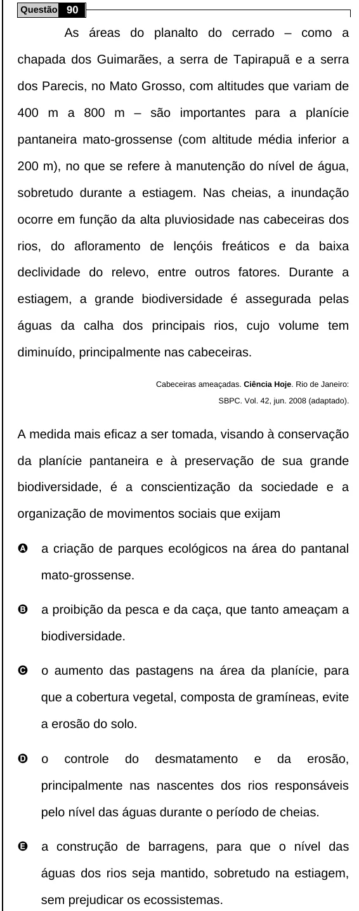

Texto extraído (pode conter ruído)

Questão 90  
As áreas do planalto do cerrado – como a  
chapada dos Guimarães, a serra de Tapirapuã e a serra  
dos Parecis, no Mato Grosso, com altitudes que variam de  
400 m a 800 m – são importantes para a planície  
pantaneira mato-grossense (com altitude média inferior a  
200 m), no que se refere à manutenção do nível de água,  
sobretudo durante a estiagem. Nas cheias, a inundação  
ocorre em função da alta pluviosidade nas cabeceiras dos  
rios, do afloramento de lençóis freáticos e da baixa  
declividade do relevo, entre outros fatores. Durante a  
estiagem, a grande biodiversidade é assegurada pelas  
águas da calha dos principais rios, cujo volume tem  
diminuído, principalmente nas cabeceiras.  
Cabeceiras ameaçadas. Ciência Hoje. Rio de Janeiro:  
SBPC. Vol. 42, jun. 2008 (adaptado).  
A medida mais eficaz a ser tomada, visando à conservação  
da planície pantaneira e à preservação de sua grande  
biodiversidade, é a conscientização da sociedade e a  
organização de movimentos sociais que exijam  
A  
a criação de parques ecológicos na área do pantanal  
mato-grossense.  
B  
a proibição da pesca e da caça, que tanto ameaçam a  
biodiversidade.  
C  
o aumento das pastagens na área da planície, para  
que a cobertura vegetal, composta de gramíneas, evite  
a erosão do solo.  
D  
o  
controle  
do  
desmatamento  
e  
da  
erosão,  
principalmente nas nascentes dos rios responsáveis  
pelo nível das águas durante o período de cheias.  
E  
a construção de barragens, para que o nível das  
águas dos rios seja mantido, sobretudo na estiagem,  
sem prejudicar os ecossistemas.

