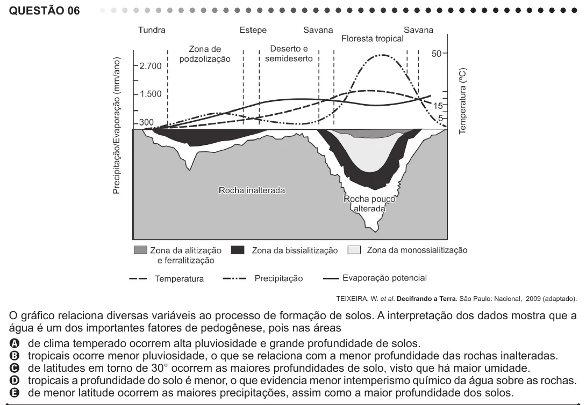

Texto extraído (pode conter ruído)

QUESTÃO 06  
TEIXEIRA, W. et al. Decifrando a Terra. São Paulo: Nacional, 2009 (adaptado).  
O gráfico relaciona diversas variáveis ao processo de formação de solos. A interpretação dos dados mostra que a  
água é um dos importantes fatores de pedogênese, pois nas áreas  
A de clima temperado ocorrem alta pluviosidade e grande profundidade de solos.  
B tropicais ocorre menor pluviosidade, o que se relaciona com a menor profundidade das rochas inalteradas.  
C de latitudes em torno de 30° ocorrem as maiores profundidades de solo, visto que há maior umidade.  
D tropicais a profundidade do solo é menor, o que evidencia menor intemperismo químico da água sobre as rochas.  
E de menor latitude ocorrem as maiores precipitações, assim como a maior profundidade dos solos.

