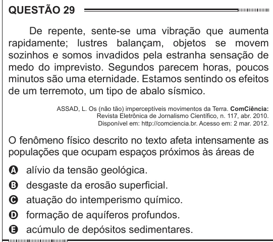

Texto extraído (pode conter ruído)

QUESTÃO 29  
De repente, sente-se uma vibração que aumenta  
rapidamente; lustres balançam, objetos se movem  
sozinhos e somos invadidos pela estranha sensação de  
medo do imprevisto. Segundos parecem horas, poucos  
minutos são uma eternidade. Estamos sentindo os efeitos  
de um terremoto, um tipo de abalo sísmico.  
ASSAD, L. Os (não tão) imperceptíveis movimentos da Terra. ComCiência:  
Revista Eletrônica de Jornalismo Científico, n. 117, abr. 2010.  
Disponível em: http://comciencia.br. Acesso em: 2 mar. 2012.  
O fenômeno físico descrito no texto afeta intensamente as  
populações que ocupam espaços próximos às áreas de  
alívio da tensão geológica.  
A  
desgaste da erosão superficial.  
B  
atuação do intemperismo químico.  
C  
D  
formação de aquíferos profundos.  
acúmulo de depósitos sedimentares.  
E

