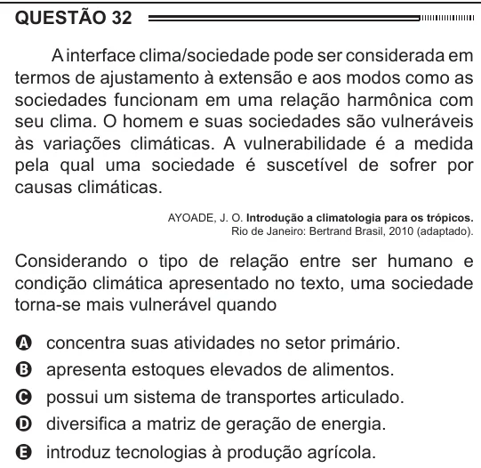

Texto extraído (pode conter ruído)

QUESTÃO 32  
A interface clima/sociedade pode ser considerada em  
termos de ajustamento à extensão e aos modos como as  
sociedades funcionam em uma relação harmônica com  
seu clima. O homem e suas sociedades são vulneráveis  
às variações climáticas. A vulnerabilidade é a medida  
pela qual uma sociedade é suscetível de sofrer por  
causas climáticas.  
AYOADE, J. O. Introdução a climatologia para os trópicos.  
Rio de Janeiro: Bertrand Brasil, 2010 (adaptado).  
Considerando o tipo de relação entre ser humano e  
condição climática apresentado no texto, uma sociedade  
torna-se mais vulnerável quando  
A concentra suas atividades no setor primário.  
B apresenta estoques elevados de alimentos.  
C possui um sistema de transportes articulado.  
D diversifica a matriz de geração de energia.  
E introduz tecnologias à produção agrícola.

