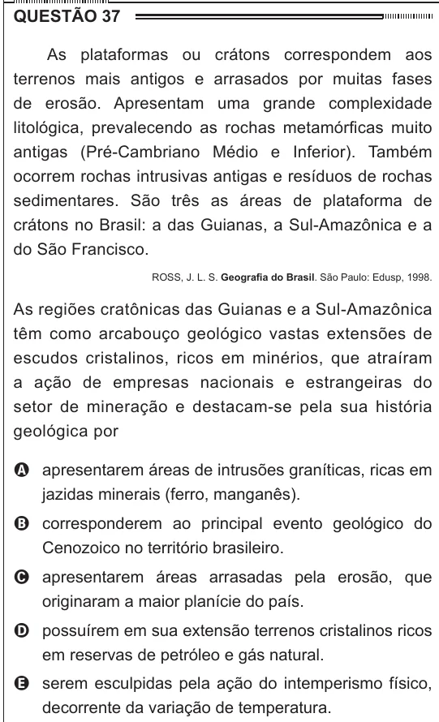

Texto extraído (pode conter ruído)

QUESTÃO 37  
As plataformas ou crátons correspondem aos  
terrenos mais antigos e arrasados por muitas fases  
de erosão. Apresentam uma grande complexidade  
litológica, prevalecendo as rochas metamórficas muito  
antigas (Pré-Cambriano Médio e Inferior). Também  
ocorrem rochas intrusivas antigas e resíduos de rochas  
sedimentares. São três as áreas de plataforma de  
crátons no Brasil: a das Guianas, a Sul-Amazônica e a  
do São Francisco.  
ROSS, J. L. S. Geografia do Brasil. São Paulo: Edusp, 1998.  
As regiões cratônicas das Guianas e a Sul-Amazônica  
têm como arcabouço geológico vastas extensões de  
escudos cristalinos, ricos em minérios, que atraíram  
a ação de empresas nacionais e estrangeiras do  
setor de mineração e destacam-se pela sua história  
geológica por  
A apresentarem áreas de intrusões graníticas, ricas em  
jazidas minerais (ferro, manganês).  
B corresponderem ao principal evento geológico do  
Cenozoico no território brasileiro.  
C apresentarem áreas arrasadas pela erosão, que  
originaram a maior planície do país.  
D possuírem em sua extensão terrenos cristalinos ricos  
em reservas de petróleo e gás natural.  
E serem esculpidas pela ação do intemperismo físico,  
decorrente da variação de temperatura.

