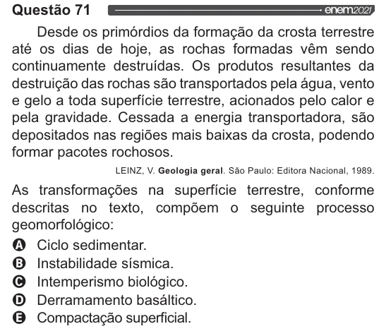

Texto extraído (pode conter ruído)

Questão 71  
Desde os primórdios da formação da crosta terrestre  
até os dias de hoje, as rochas formadas vêm sendo  
continuamente destruídas. Os produtos resultantes da  
destruição das rochas são transportados pela água, vento  
e gelo a toda superfície terrestre, acionados pelo calor e  
pela gravidade. Cessada a energia transportadora, são  
depositados nas regiões mais baixas da crosta, podendo  
formar pacotes rochosos.  
LEINZ, V. Geologia geral. São Paulo: Editora Nacional, 1989.  
As transformações na superfície terrestre, conforme  
descritas no texto, compõem o seguinte processo  
geomorfológico:  
VOVOO  
Ciclo sedimentar.  
Instabilidade sísmica.  
Intemperismo biológico.  
Derramamento basáltico.  
Compactação superficial.

