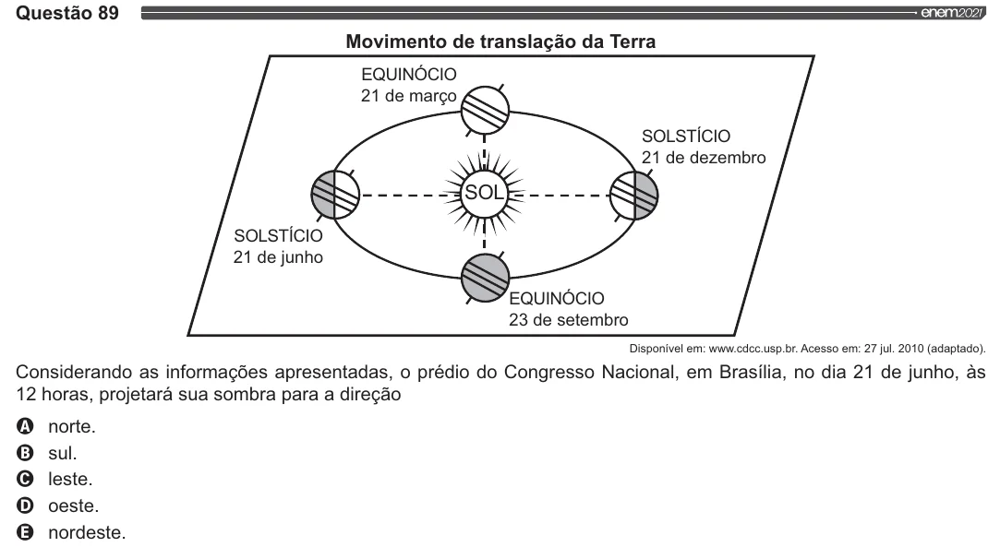

Texto extraído (pode conter ruído)

Questão 89  
Movimento de translação da Terra  
EQUINÓCIO  
21 de março  
SOLSTÍCIO  
21 de dezembro  
SOLSTÍCIO  
21 de junho  
EQUINÓCIO  
23 de setembro  
Disponível em: www.cdec.usp.br. Acesso em: 27 jul. 2010 (adaptado).  
Considerando as informações apresentadas, o prédio do Congresso Nacional, em Brasília, no dia 21 de junho, às  
12 horas, projetará sua sombra para a direção  
VOOS  
norte.  
sul.  
leste.  
oeste.  
nordeste.

