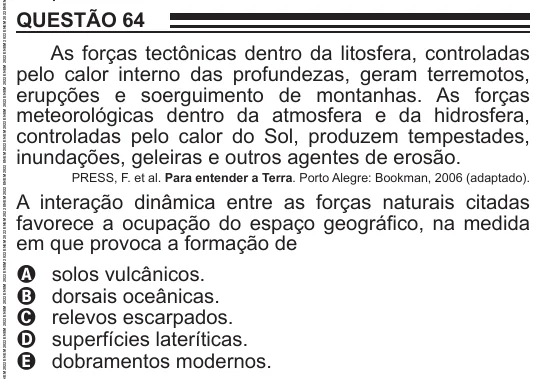

Texto extraído (pode conter ruído)

QUESTÃO 64  
As forças tectônicas dentro da litosfera, controladas  
pelo calor interno das profundezas, geram terremotos,  
erupções e soerguimento de montanhas. As forças  
meteorológicas dentro da atmosfera e da hidrosfera,  
controladas pelo calor do Sol, produzem tempestades,  
inundações, geleiras e outros agentes de erosão.  
PRESS, F. et al. Para entender a Terra. Porto Alegre: Bookman, 2006 (adaptado).  
A interação dinâmica entre as forças naturais citadas  
favorece a ocupação do espaço geográfico, na medida  
em que provoca a formação de  
solos vulcânicos.  
A  
B  
dorsais oceânicas.  
relevos escarpados.  
C  
superfícies lateríticas.  
D  
dobramentos modernos.  
E

