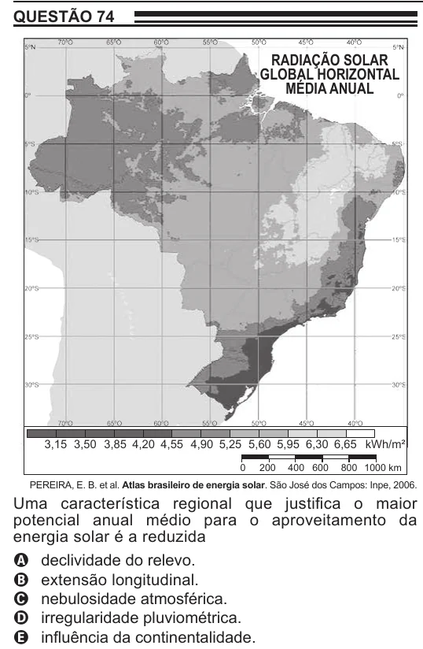

Texto extraído (pode conter ruído)

QUESTÃO 74  
RADIAÇÃO SOLAR  
GLOBAL HORIZONTAL  
MÉDIA ANUAL  
3,15 3,50 3,85 4,20 4,55 4,90 5,25 5,60 5,95 6,30 6,65 kWh/m²  
0  
200  
400 600  
800 1000 km  
PEREIRA, E. B. et al. Atlas brasileiro de energia solar. São José dos Campos: Inpe, 2006.  
Uma característica regional que justifica o maior  
potencial anual médio para o aproveitamento da  
energia solar é a reduzida  
A declividade do relevo.  
B extensão longitudinal.  
C nebulosidade atmosférica.  
D irregularidade pluviométrica.  
E influência da continentalidade.

