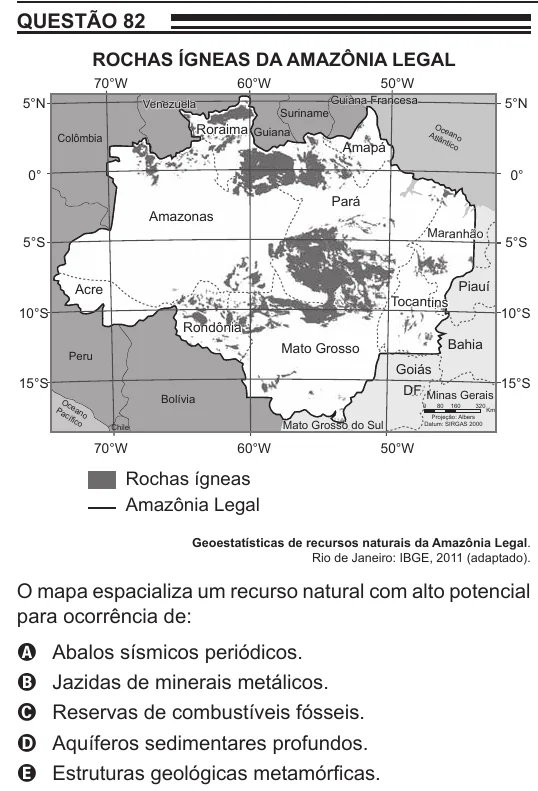

Texto extraído (pode conter ruído)

QUESTÃO 82  
ROCHAS ÍGNEAS DA AMAZÔNIA LEGAL  
70°W  
60°W  
50°W  
Guiana Francesa  
5°N  
Venezuela  
5°N  
Suriname  
Roraima Guiana  
Oc  
Colômbia  
Atl eano  
ânti  
Amapá  
co  
0°  
0°  
Pará  
Amazonas  
Maranhão  
aranhão  
5°S  
5°S  
Acre  
Piauí  
Tocantins  
10°S  
10°S  
Rondônia  
Bahia  
Mato Grosso  
Peru  
Goiás  
15°S  
15°S  
DF Minas Gerais  
Bolívia  
Oc  
Pa ean  
0  
80  
160  
320  
cíf o  
Km  
ico  
Mato Grosso do Sul  
Projeção: Albers  
Chile  
Datum: SIRGAS 2000  
70°W  
60°W  
50°W  
Rochas ígneas  
Amazônia Legal  
Geoestatísticas de recursos naturais da Amazônia Legal.  
Rio de Janeiro: IBGE, 2011 (adaptado).  
O mapa espacializa um recurso natural com alto potencial  
para ocorrência de:  
A  
Abalos sísmicos periódicos.  
Jazidas de minerais metálicos.  
B  
Reservas de combustíveis fósseis.  
C  
Aquíferos sedimentares profundos.  
D  
Estruturas geológicas metamórficas.  
E

