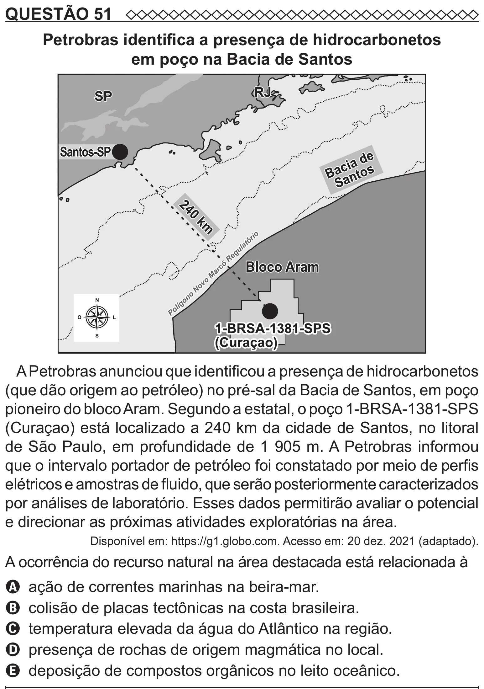

Texto extraído (pode conter ruído)

QUESTÃO 51  
Petrobras identifica a presença de hidrocarbonetos  
em poço na Bacia de Santos  
A Petrobras anunciou que identificou a presença de hidrocarbonetos  
(que dão origem ao petróleo) no pré-sal da Bacia de Santos, em poço  
pioneiro do bloco Aram. Segundo a estatal, o poço 1-BRSA-1381-SPS  
(Curaçao) está localizado a 240 km da cidade de Santos, no litoral  
de São Paulo, em profundidade de 1 905 m. A Petrobras informou  
que o intervalo portador de petróleo foi constatado por meio de perfis  
elétricos e amostras de fluido, que serão posteriormente caracterizados  
por análises de laboratório. Esses dados permitirão avaliar o potencial  
e direcionar as próximas atividades exploratórias na área.  
Disponível em: https://g1.globo.com. Acesso em: 20 dez. 2021 (adaptado).  
A ocorrência do recurso natural na área destacada está relacionada à  
A ação de correntes marinhas na beira-mar.  
B colisão de placas tectônicas na costa brasileira.  
C temperatura elevada da água do Atlântico na região.  
D presença de rochas de origem magmática no local.  
E deposição de compostos orgânicos no leito oceânico.

