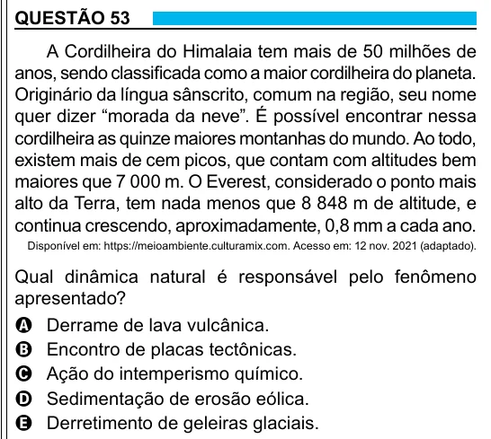

Texto extraído (pode conter ruído)

QUESTÃO 53  
A Cordilheira do Himalaia tem mais de 50 milhões de  
anos, sendo classificada como a maior cordilheira do planeta.  
Originário da língua sânscrito, comum na região, seu nome  
quer dizer “morada da neve”. É possível encontrar nessa  
cordilheira as quinze maiores montanhas do mundo. Ao todo,  
existem mais de cem picos, que contam com altitudes bem  
maiores que 7 000 m. O Everest, considerado o ponto mais  
alto da Terra, tem nada menos que 8 848 m de altitude, e  
continua crescendo, aproximadamente, 0,8 mm a cada ano.  
Disponível em: https://meioambiente.culturamix.com. Acesso em: 12 nov. 2021 (adaptado).  
Qual dinâmica natural é responsável pelo fenômeno  
apresentado?  
A Derrame de lava vulcânica.  
B Encontro de placas tectônicas.  
C Ação do intemperismo químico.  
D Sedimentação de erosão eólica.  
E Derretimento de geleiras glaciais.

