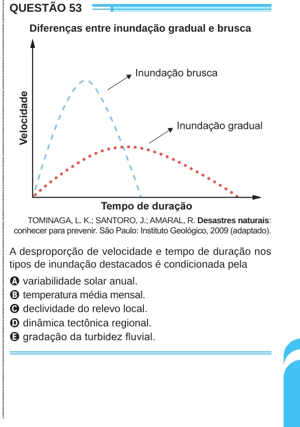

Texto extraído (pode conter ruído)

QUESTÃO 53  
Diferenças entre inundação gradual e brusca  
TOMINAGA, L. K.; SANTORO, J.; AMARAL, R. Desastres naturais:  
conhecer para prevenir. São Paulo: Instituto Geológico, 2009 (adaptado).  
A desproporção de velocidade e tempo de duração nos  
tipos de inundação destacados é condicionada pela  
A variabilidade solar anual.  
B temperatura média mensal.  
C declividade do relevo local.  
D dinâmica tectônica regional.  
E gradação da turbidez fluvial.

