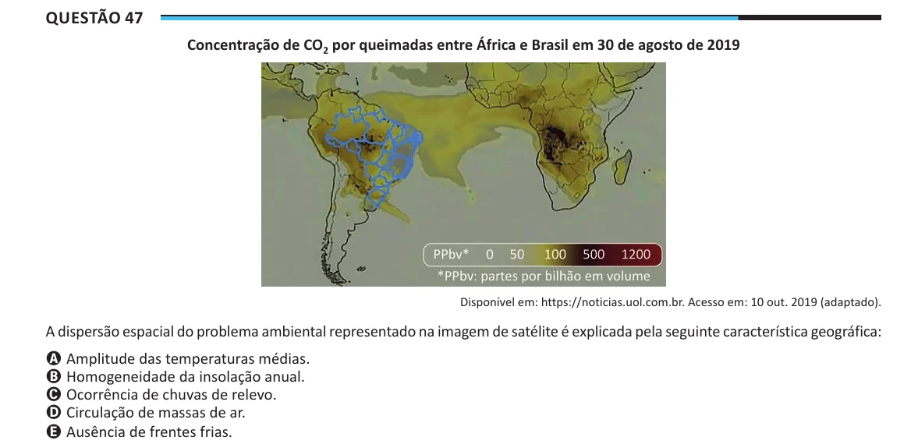

Texto extraído (pode conter ruído)

Questão 47  
Concentração de CO 2 por queimadas entre África e Brasil em 30 de agosto de 2019  
Disponível em: https://noticias.uol.com.br. Acesso em: 10 out. 2019 (adaptado).  
A dispersão espacial do problema ambiental representado na imagem de satélite é explicada pela seguinte característica geográfica:  
A Amplitude das temperaturas médias.  
B Homogeneidade da insolação anual.  
C Ocorrência de chuvas de relevo.  
D Circulação de massas de ar.  
E Ausência de frentes frias.

