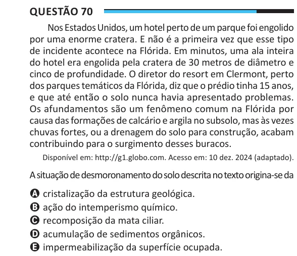

Texto extraído (pode conter ruído)

Questão 70  
Nos Estados Unidos, um hotel perto de um parque foi engolido  
por uma enorme cratera. E não é a primeira vez que esse tipo  
de incidente acontece na Flórida. Em minutos, uma ala inteira  
do hotel era engolida pela cratera de 30 metros de diâmetro e  
cinco de profundidade. O diretor do resort em Clermont, perto  
dos parques temáticos da Flórida, diz que o prédio tinha 15 anos,  
e que até então o solo nunca havia apresentado problemas.  
Os afundamentos são um fenômeno comum na Flórida por  
causa das formações de calcário e argila no subsolo, mas às vezes  
chuvas fortes, ou a drenagem do solo para construção, acabam  
contribuindo para o surgimento desses buracos.  
Disponível em: http://g1.globo.com. Acesso em: 10 dez. 2024 (adaptado).  
A situação de desmoronamento do solo descrita no texto origina-se da  
A cristalização da estrutura geológica.  
B ação do intemperismo químico.  
C recomposição da mata ciliar.  
D acumulação de sedimentos orgânicos.  
E impermeabilização da superfície ocupada.

