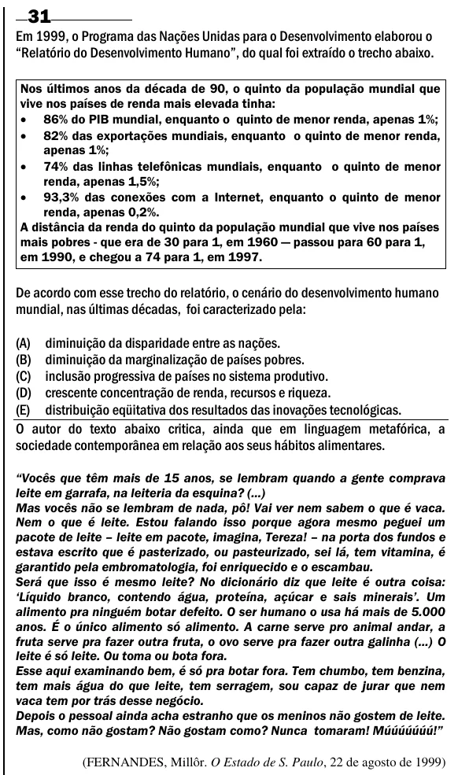

Texto extraído (pode conter ruído)

31  
Em 1999, o Programa das Nações Unidas para o Desenvolvimento elaborou o  
“Relatório do Desenvolvimento Humano”, do qual foi extraído o trecho abaixo.  
Nos últimos anos da década de 90, o quinto da população mundial que  
vive nos países de renda mais elevada tinha:  
 86% do PIB mundial, enquanto o quinto de menor renda, apenas 1%;  
 82% das exportações mundiais, enquanto o quinto de menor renda,  
apenas 1%;  
 74% das linhas telefônicas mundiais, enquanto o quinto de menor  
renda, apenas 1,5%;  
 93,3% das conexões com a Internet, enquanto o quinto de menor  
renda, apenas 0,2%.  
A distância da renda do quinto da população mundial que vive nos países  
mais pobres - que era de 30 para 1, em 1960 — passou para 60 para 1,  
em 1990, e chegou a 74 para 1, em 1997.  
De acordo com esse trecho do relatório, o cenário do desenvolvimento humano  
mundial, nas últimas décadas, foi caracterizado pela:  
(A) diminuição da disparidade entre as nações.  
(B) diminuição da marginalização de países pobres.  
(C) inclusão progressiva de países no sistema produtivo.  
(D) crescente concentração de renda, recursos e riqueza.  
(E) distribuição eqüitativa dos resultados das inovações tecnológicas.  
O autor do texto abaixo critica, ainda que em linguagem metafórica, a  
sociedade contemporânea em relação aos seus hábitos alimentares.  
―Vocês que têm mais de 15 anos, se lembram quando a gente comprava  
leite em garrafa, na leiteria da esquina? (...)  
Mas vocês não se lembram de nada, pô! Vai ver nem sabem o que é vaca.  
Nem o que é leite. Estou falando isso porque agora mesmo peguei um  
pacote de leite – leite em pacote, imagina, Tereza! – na porta dos fundos e  
estava escrito que é pasterizado, ou pasteurizado, sei lá, tem vitamina, é  
garantido pela embromatologia, foi enriquecido e o escambau.  
Será que isso é mesmo leite? No dicionário diz que leite é outra coisa:  
‗Líquido branco, contendo água, proteína, açúcar e sais minerais‘. Um  
alimento pra ninguém botar defeito. O ser humano o usa há mais de 5.000  
anos. É o único alimento só alimento. A carne serve pro animal andar, a  
fruta serve pra fazer outra fruta, o ovo serve pra fazer outra galinha (...) O  
leite é só leite. Ou toma ou bota fora.  
Esse aqui examinando bem, é só pra botar fora. Tem chumbo, tem benzina,  
tem mais água do que leite, tem serragem, sou capaz de jurar que nem  
vaca tem por trás desse negócio.  
Depois o pessoal ainda acha estranho que os meninos não gostem de leite.  
Mas, como não gostam? Não gostam como? Nunca tomaram! Múúúúúúú!‖  
(FERNANDES, Millôr. O Estado de S. Paulo, 22 de agosto de 1999)

