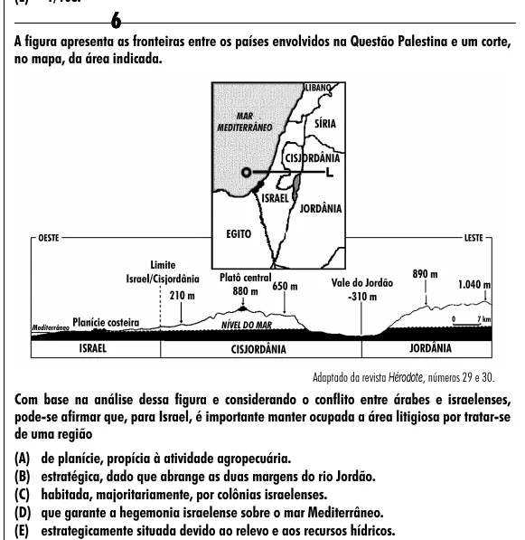

Texto extraído (pode conter ruído)

6  
A figura apresenta as fronteiras entre os países envolvidos na Questão Palestina e um corte,  
no mapa, da área indicada.  
Adaptado da revista Hérodote, números 29 e 30.  
Com base na análise dessa figura e considerando o conflito entre árabes e israelenses,  
pode-se afirmar que, para Israel, é importante manter ocupada a área litigiosa por tratar-se  
de uma região  
(A) de planície, propícia à atividade agropecuária.  
(B) estratégica, dado que abrange as duas margens do rio Jordão.  
(C) habitada, majoritariamente, por colônias israelenses.  
(D) que garante a hegemonia israelense sobre o mar Mediterrâneo.  
(E) estrategicamente situada devido ao relevo e aos recursos hídricos.

