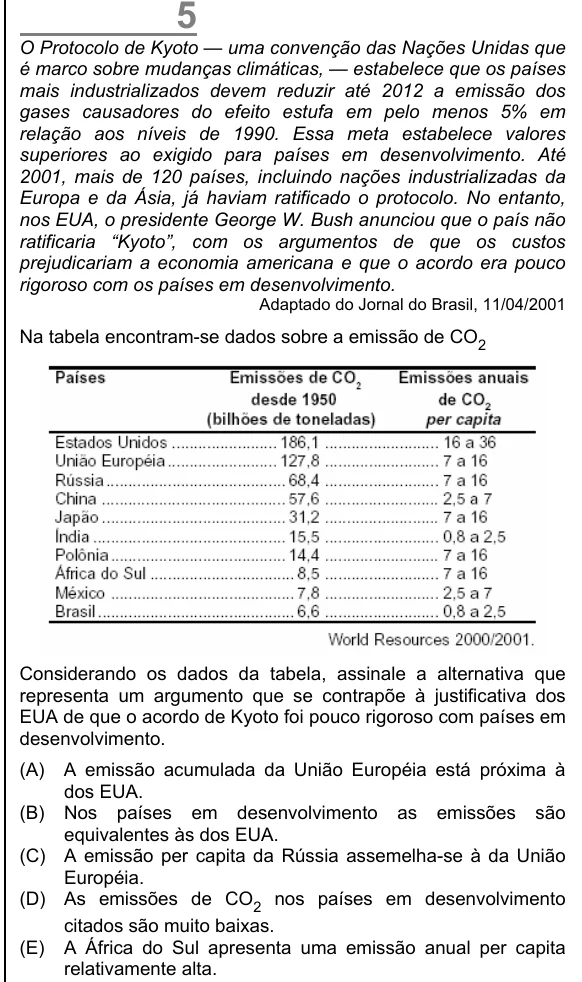

Texto extraído (pode conter ruído)

O Protocolo de Kyoto — uma convenção das Nações Unidas que  
é marco sobre mudanças climáticas, — estabelece que os países  
mais industrializados devem reduzir até 2012 a emissão dos  
gases causadores do efeito estufa em pelo menos 5% em  
relação aos níveis de 1990. Essa meta estabelece valores  
superiores ao exigido para países em desenvolvimento. Até  
2001, mais de 120 países, incluindo nações industrializadas da  
Europa e da Ásia, já haviam ratificado o protocolo. No entanto,  
nos EUA, o presidente George W. Bush anunciou que o país não  
ratificaria “Kyoto”, com os argumentos de que os custos  
prejudicariam a economia americana e que o acordo era pouco  
rigoroso com os países em desenvolvimento.  
Adaptado do Jornal do Brasil, 11/04/2001  
Na tabela encontram-se dados sobre a emissão de CO 2  
Considerando os dados da tabela, assinale a alternativa que  
representa um argumento que se contrapõe à justificativa dos  
EUA de que o acordo de Kyoto foi pouco rigoroso com países em  
desenvolvimento.  
(A)  
A emissão acumulada da União Européia está próxima à  
dos EUA.  
(B) Nos países em desenvolvimento as emissões são  
equivalentes às dos EUA.  
(C) A emissão per capita da Rússia assemelha-se à da União  
Européia.  
(D) As emissões de CO 2 nos países em desenvolvimento  
citados são muito baixas.  
(E) A África do Sul apresenta uma emissão anual per capita  
relativamente alta.

