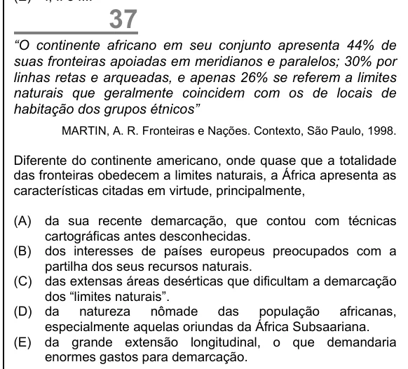

Texto extraído (pode conter ruído)

37  
“O continente africano em seu conjunto apresenta 44% de  
suas fronteiras apoiadas em meridianos e paralelos; 30% por  
linhas retas e arqueadas, e apenas 26% se referem a limites  
naturais que geralmente coincidem com os de locais de  
habitação dos grupos étnicos”  
MARTIN, A. R. Fronteiras e Nações. Contexto, São Paulo, 1998.  
Diferente do continente americano, onde quase que a totalidade  
das fronteiras obedecem a limites naturais, a África apresenta as  
características citadas em virtude, principalmente,  
(A)  
da sua recente demarcação, que contou com técnicas  
cartográficas antes desconhecidas.  
(B) dos interesses de países europeus preocupados com a  
partilha dos seus recursos naturais.  
(C) das extensas áreas desérticas que dificultam a demarcação  
dos “limites naturais”.  
(D) da  
natureza  
nômade  
das  
população  
africanas,  
especialmente aquelas oriundas da África Subsaariana.  
(E) da grande extensão longitudinal, o que demandaria  
enormes gastos para demarcação.

