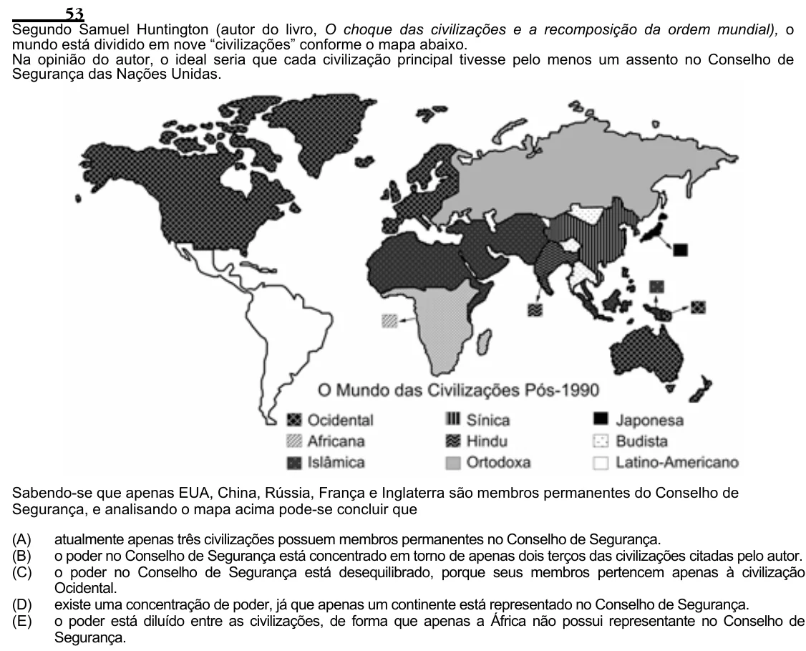

Texto extraído (pode conter ruído)

53  
Segundo Samuel Huntington (autor do livro, O choque das civilizações e a recomposição da ordem mundial), o  
mundo está dividido em nove “civilizações” conforme o mapa abaixo.  
Na opinião do autor, o ideal seria que cada civilização principal tivesse pelo menos um assento no Conselho de  
Segurança das Nações Unidas.  
Sabendo-se que apenas EUA, China, Rússia, França e Inglaterra são membros permanentes do Conselho de  
Segurança, e analisando o mapa acima pode-se concluir que  
(A)  
atualmente apenas três civilizações possuem membros permanentes no Conselho de Segurança.  
(B)  
o poder no Conselho de Segurança está concentrado em torno de apenas dois terços das civilizações citadas pelo autor.  
(C)  
o poder no Conselho de Segurança está desequilibrado, porque seus membros pertencem apenas à civilização  
Ocidental.  
(D)  
existe uma concentração de poder, já que apenas um continente está representado no Conselho de Segurança.  
(E)  
o poder está diluído entre as civilizações, de forma que apenas a África não possui representante no Conselho de  
Segurança.

