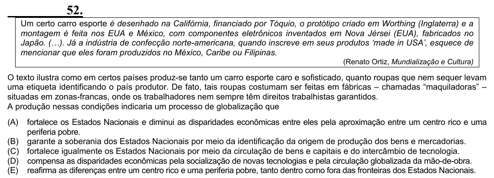

Texto extraído (pode conter ruído)

52.  
Um certo carro esporte é desenhado na Califórnia, financiado por Tóquio, o protótipo criado em Worthing (Inglaterra) e a  
montagem é feita nos EUA e México, com componentes eletrônicos inventados em Nova Jérsei (EUA), fabricados no  
Japão. (…). Já a indústria de confecção norte-americana, quando inscreve em seus produtos ‘made in USA’, esquece de  
mencionar que eles foram produzidos no México, Caribe ou Filipinas.  
(Renato Ortiz, Mundialização e Cultura)  
O texto ilustra como em certos países produz-se tanto um carro esporte caro e sofisticado, quanto roupas que nem sequer levam  
uma etiqueta identificando o país produtor. De fato, tais roupas costumam ser feitas em fábricas – chamadas “maquiladoras” –  
situadas em zonas-francas, onde os trabalhadores nem sempre têm direitos trabalhistas garantidos.  
A produção nessas condições indicaria um processo de globalização que  
(A)  
fortalece os Estados Nacionais e diminui as disparidades econômicas entre eles pela aproximação entre um centro rico e uma  
periferia pobre.  
(B) garante a soberania dos Estados Nacionais por meio da identificação da origem de produção dos bens e mercadorias.  
(C) fortalece igualmente os Estados Nacionais por meio da circulação de bens e capitais e do intercâmbio de tecnologia.  
(D) compensa as disparidades econômicas pela socialização de novas tecnologias e pela circulação globalizada da mão-de-obra.  
(E) reafirma as diferenças entre um centro rico e uma periferia pobre, tanto dentro como fora das fronteiras dos Estados Nacionais.

