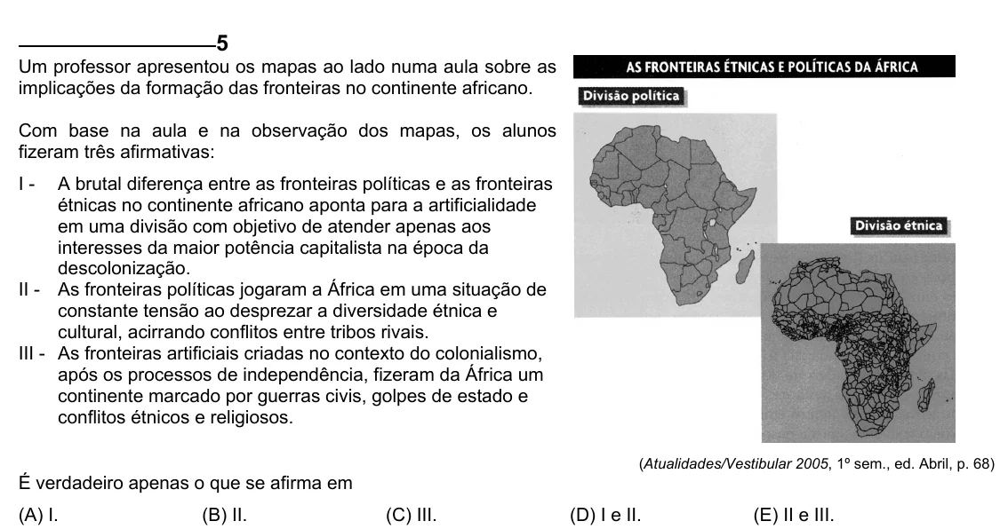

Texto extraído (pode conter ruído)

5  
Um professor apresentou os mapas ao lado numa aula sobre as  
implicações da formação das fronteiras no continente africano.  
Com base na aula e na observação dos mapas, os alunos  
fizeram três afirmativas:  
I -  
A brutal diferença entre as fronteiras políticas e as fronteiras  
étnicas no continente africano aponta para a artificialidade  
em uma divisão com objetivo de atender apenas aos  
interesses da maior potência capitalista na época da  
descolonização.  
II - As fronteiras políticas jogaram a África em uma situação de  
constante tensão ao desprezar a diversidade étnica e  
cultural, acirrando conflitos entre tribos rivais.  
III - As fronteiras artificiais criadas no contexto do colonialismo,  
após os processos de independência, fizeram da África um  
continente marcado por guerras civis, golpes de estado e  
conflitos étnicos e religiosos.  
(Atualidades/Vestibular 2005, 1º sem., ed. Abril, p. 68)  
É verdadeiro apenas o que se afirma em  
(A) I.  
(B) II.  
(C) III.  
(D) I e II.  
(E) II e III.

