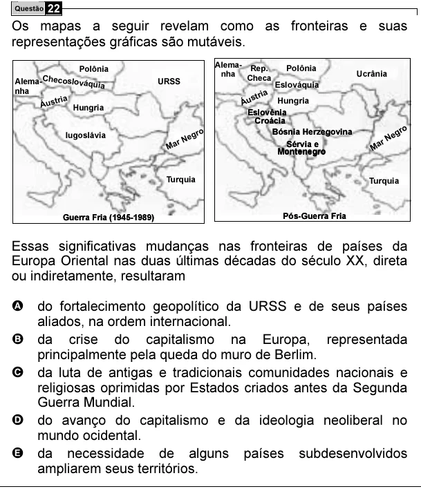

Texto extraído (pode conter ruído)

Questão 22  
Os mapas a seguir revelam como as fronteiras e suas  
representações gráficas são mutáveis.  
Alema- Rep.  
Polônia  
Polônia  
nha Checa  
Ucrânia  
Alema- Checoslováquia  
URSS  
Eslováquia  
nha  
ia  
ria  
str  
Áust  
Áu  
Hungria  
Hungria  
Eslovênia  
Croácia  
o  
o  
Bósnia Herzegovina  
gr  
Iugoslávia  
egr  
Ne  
r N  
r  
Ma  
Sérvia e  
Ma  
Montenegro  
Turquia  
Turquia  
Guerra Fria (1945-1989)  
Pós-Guerra Fria  
Essas significativas mudanças nas fronteiras de países da  
Europa Oriental nas duas últimas décadas do século XX, direta  
ou indiretamente, resultaram  
A do fortalecimento geopolítico da URSS e de seus países  
aliados, na ordem internacional.  
B da crise do capitalismo na Europa, representada  
principalmente pela queda do muro de Berlim.  
C da luta de antigas e tradicionais comunidades nacionais e  
religiosas oprimidas por Estados criados antes da Segunda  
Guerra Mundial.  
D do avanço do capitalismo e da ideologia neoliberal no  
mundo ocidental.  
E da necessidade de alguns países subdesenvolvidos  
ampliarem seus territórios.

