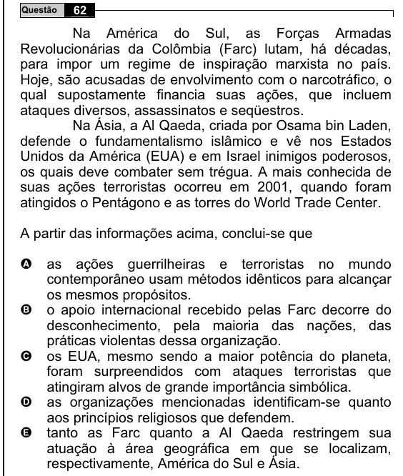

Texto extraído (pode conter ruído)

62  
Questão  
Na América do Sul, as Forças Armadas  
Revolucionárias da Colômbia (Farc) lutam, há décadas,  
para impor um regime de inspiração marxista no país.  
Hoje, são acusadas de envolvimento com o narcotráfico, o  
qual supostamente financia suas ações, que incluem  
ataques diversos, assassinatos e seqüestros.  
Na Ásia, a Al Qaeda, criada por Osama bin Laden,  
defende o fundamentalismo islâmico e vê nos Estados  
Unidos da América (EUA) e em Israel inimigos poderosos,  
os quais deve combater sem trégua. A mais conhecida de  
suas ações terroristas ocorreu em 2001, quando foram  
atingidos o Pentágono e as torres do World Trade Center.  
A partir das informações acima, conclui-se que  
A  
as ações guerrilheiras e terroristas no mundo  
contemporâneo usam métodos idênticos para alcançar  
os mesmos propósitos.  
o apoio internacional recebido pelas Farc decorre do  
B  
desconhecimento, pela maioria das nações, das  
práticas violentas dessa organização.  
C  
os EUA, mesmo sendo a maior potência do planeta,  
foram surpreendidos com ataques terroristas que  
atingiram alvos de grande importância simbólica.  
D  
as organizações mencionadas identificam-se quanto  
aos princípios religiosos que defendem.  
E  
tanto as Farc quanto a Al Qaeda restringem sua  
atuação à área geográfica em que se localizam,  
respectivamente, América do Sul e Ásia.

