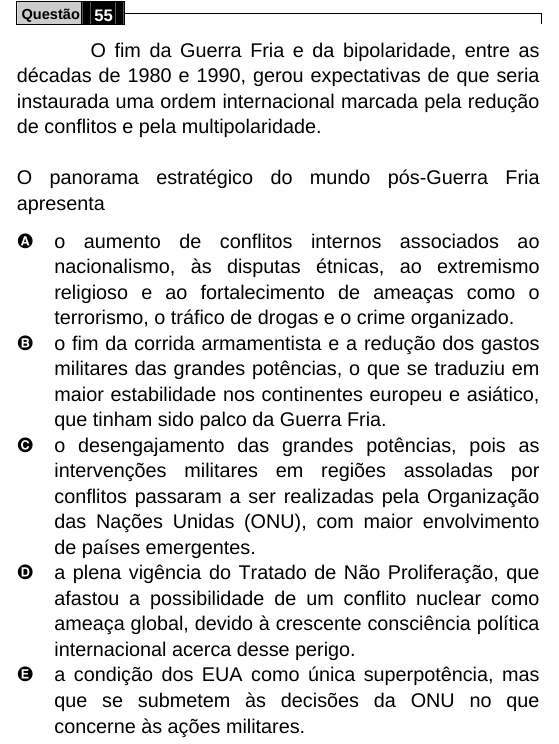

Texto extraído (pode conter ruído)

Questão 55  
O fim da Guerra Fria e da bipolaridade, entre as  
décadas de 1980 e 1990, gerou expectativas de que seria  
instaurada uma ordem internacional marcada pela redução  
de conflitos e pela multipolaridade.  
O panorama estratégico do mundo pós-Guerra Fria  
apresenta  
A  
o aumento de conflitos internos associados ao  
nacionalismo, às disputas étnicas, ao extremismo  
religioso e ao fortalecimento de ameaças como o  
terrorismo, o tráfico de drogas e o crime organizado.  
B  
o fim da corrida armamentista e a redução dos gastos  
militares das grandes potências, o que se traduziu em  
maior estabilidade nos continentes europeu e asiático,  
que tinham sido palco da Guerra Fria.  
C  
o desengajamento das grandes potências, pois as  
intervenções militares em regiões assoladas por  
conflitos passaram a ser realizadas pela Organização  
das Nações Unidas (ONU), com maior envolvimento  
de países emergentes.  
D  
a plena vigência do Tratado de Não Proliferação, que  
afastou a possibilidade de um conflito nuclear como  
ameaça global, devido à crescente consciência política  
internacional acerca desse perigo.  
E  
a condição dos EUA como única superpotência, mas  
que se submetem às decisões da ONU no que  
concerne às ações militares.

