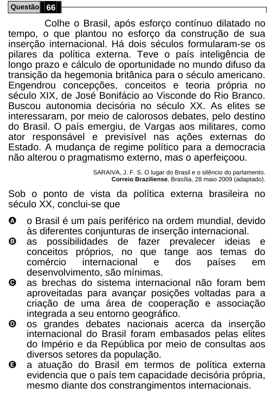

Texto extraído (pode conter ruído)

Questão 66  
Colhe o Brasil, após esforço contínuo dilatado no  
tempo, o que plantou no esforço da construção de sua  
inserção internacional. Há dois séculos formularam-se os  
pilares da política externa. Teve o país inteligência de  
longo prazo e cálculo de oportunidade no mundo difuso da  
transição da hegemonia britânica para o século americano.  
Engendrou concepções, conceitos e teoria própria no  
século XIX, de José Bonifácio ao Visconde do Rio Branco.  
Buscou autonomia decisória no século XX. As elites se  
interessaram, por meio de calorosos debates, pelo destino  
do Brasil. O país emergiu, de Vargas aos militares, como  
ator responsável e previsível nas ações externas do  
Estado. A mudança de regime político para a democracia  
não alterou o pragmatismo externo, mas o aperfeiçoou.  
SARAIVA, J. F. S. O lugar do Brasil e o silêncio do parlamento.  
Correio Braziliense, Brasília, 28 maio 2009 (adaptado).  
Sob o ponto de vista da política externa brasileira no  
século XX, conclui-se que  
A  
o Brasil é um país periférico na ordem mundial, devido  
às diferentes conjunturas de inserção internacional.  
B  
as possibilidades de fazer prevalecer ideias e  
conceitos próprios, no que tange aos temas do  
comércio  
internacional  
e  
dos  
países  
em  
desenvolvimento, são mínimas.  
C  
as brechas do sistema internacional não foram bem  
aproveitadas para avançar posições voltadas para a  
criação de uma área de cooperação e associação  
integrada a seu entorno geográfico.  
D  
os grandes debates nacionais acerca da inserção  
internacional do Brasil foram embasados pelas elites  
do Império e da República por meio de consultas aos  
diversos setores da população.  
E  
a atuação do Brasil em termos de política externa  
evidencia que o país tem capacidade decisória própria,  
mesmo diante dos constrangimentos internacionais.

