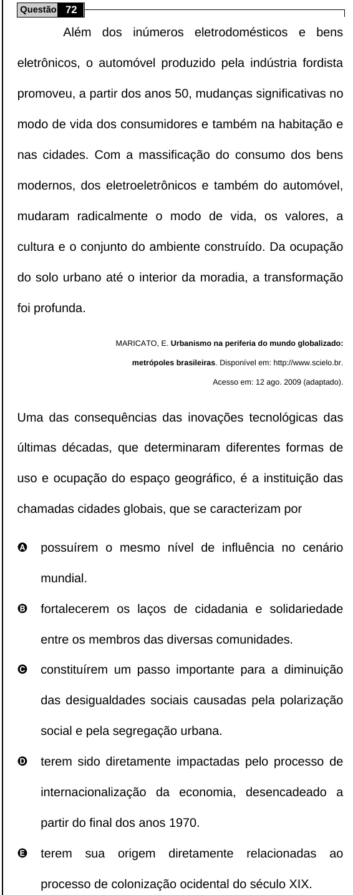

Texto extraído (pode conter ruído)

Questão 72  
Além dos inúmeros eletrodomésticos e bens  
eletrônicos, o automóvel produzido pela indústria fordista  
promoveu, a partir dos anos 50, mudanças significativas no  
modo de vida dos consumidores e também na habitação e  
nas cidades. Com a massificação do consumo dos bens  
modernos, dos eletroeletrônicos e também do automóvel,  
mudaram radicalmente o modo de vida, os valores, a  
cultura e o conjunto do ambiente construído. Da ocupação  
do solo urbano até o interior da moradia, a transformação  
foi profunda.  
MARICATO, E. Urbanismo na periferia do mundo globalizado:  
metrópoles brasileiras. Disponível em: http://www.scielo.br.  
Acesso em: 12 ago. 2009 (adaptado).  
Uma das consequências das inovações tecnológicas das  
últimas décadas, que determinaram diferentes formas de  
uso e ocupação do espaço geográfico, é a instituição das  
chamadas cidades globais, que se caracterizam por  
A  
possuírem o mesmo nível de influência no cenário  
mundial.  
B  
fortalecerem os laços de cidadania e solidariedade  
entre os membros das diversas comunidades.  
C  
constituírem um passo importante para a diminuição  
das desigualdades sociais causadas pela polarização  
social e pela segregação urbana.  
D  
terem sido diretamente impactadas pelo processo de  
internacionalização da economia, desencadeado a  
partir do final dos anos 1970.  
E  
terem  
sua  
origem  
diretamente  
relacionadas  
ao  
processo de colonização ocidental do século XIX.

